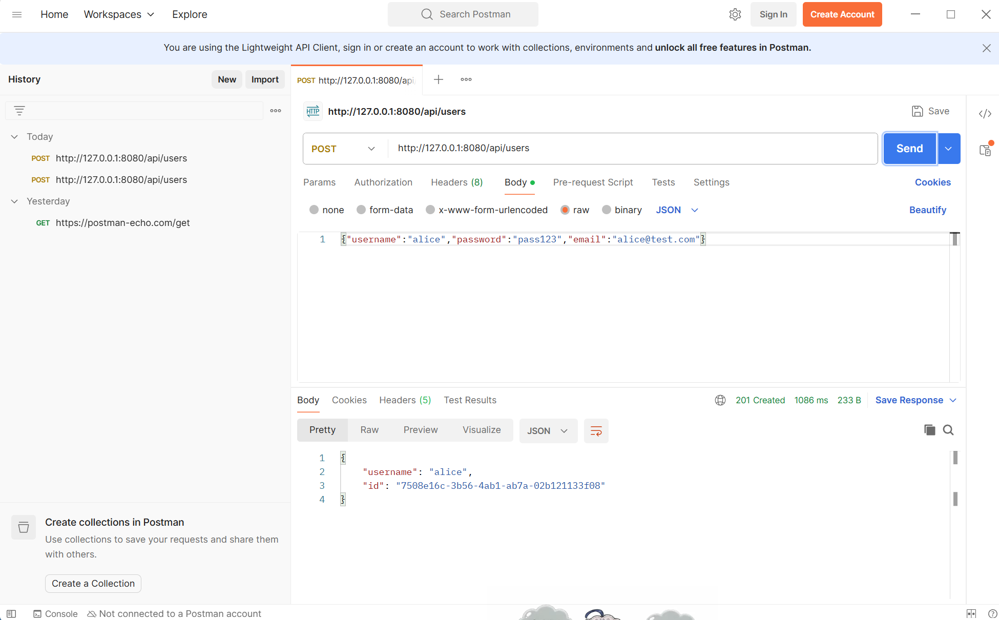
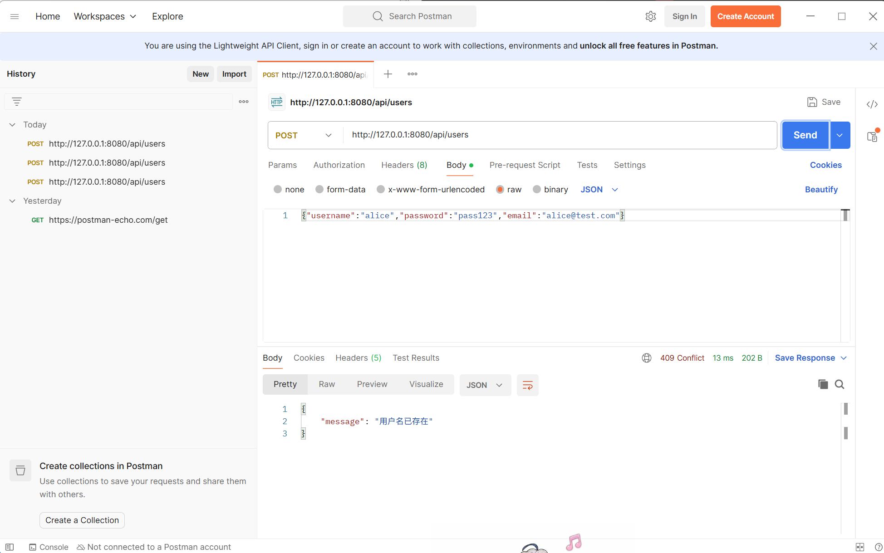
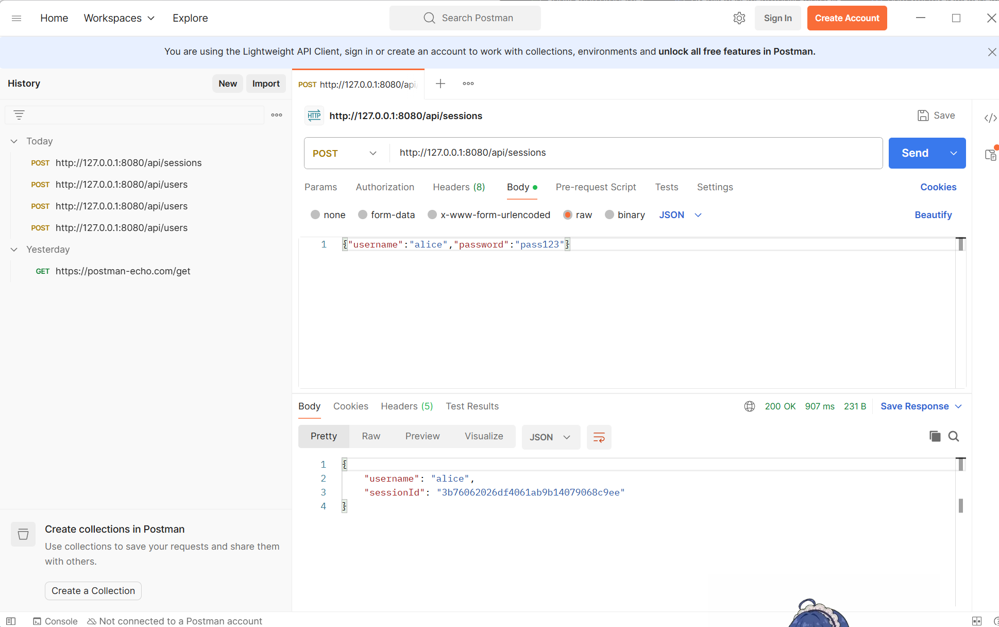
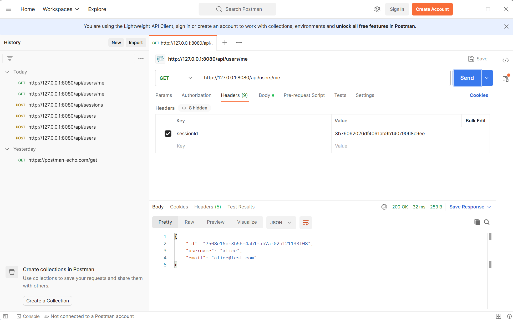
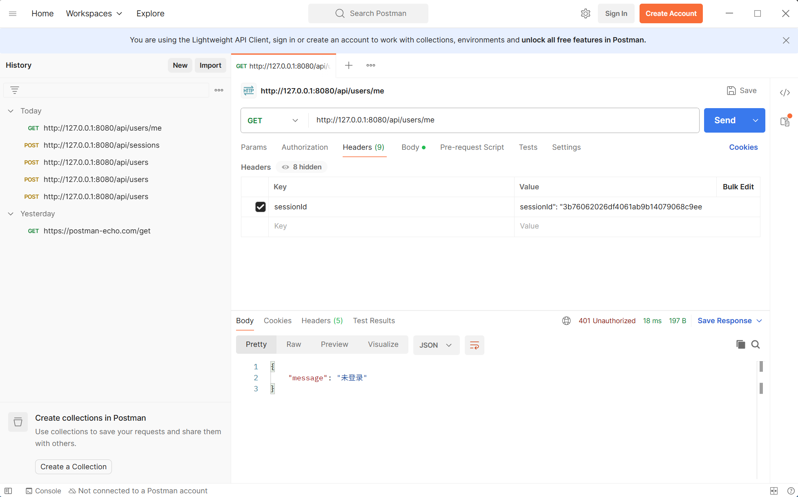
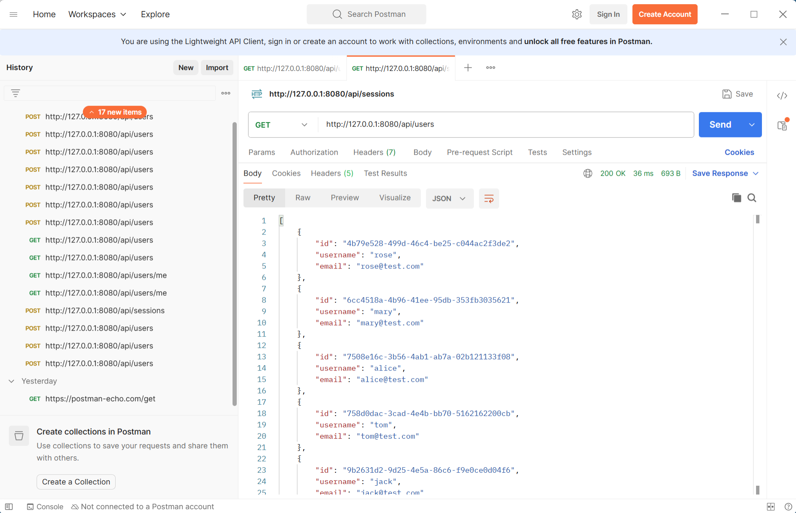
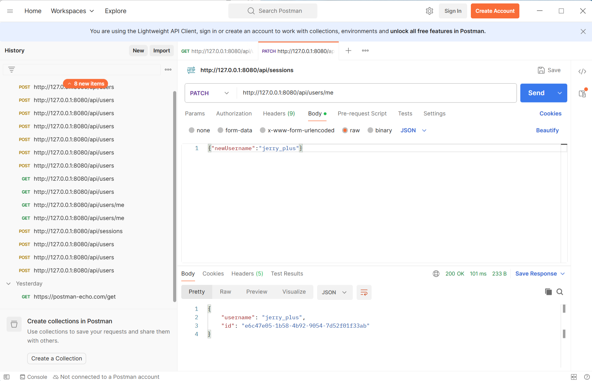
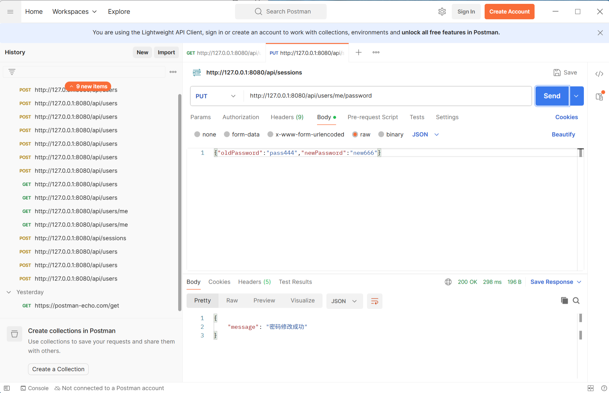
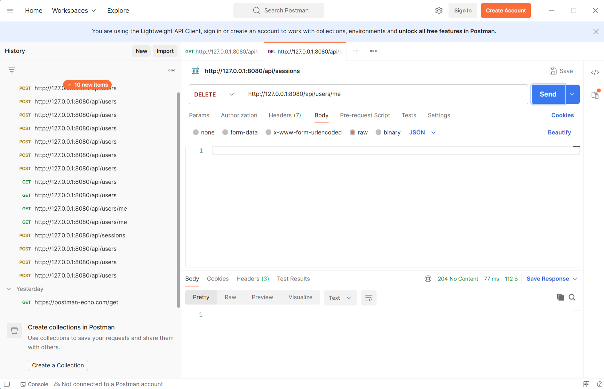

# 用户管理系统

## 一、功能

### 必做

- [x] 用户注册（密码 BCrypt 哈希存储）
- [x] 用户登录，返回随机 `sessionId`
- [x] 查看当前登录用户（请求头携带 `sessionId`）

### 选做

- [x] 查看用户列表
- [x] 修改用户名
- [x] 修改密码
- [x] 注销账号

### 边界处理

- 重复注册 → `409`
- 用户名/密码为空 → `400`
- 未登录 / sessionId 无效 → `401`
- 用户不存在 → `404`
- 原密码错误 → `400`

---

## 二、接口

| 功能 | 方法 | URL | 认证 | 成功 | 失败 |
|---|---|---|---|---|---|
| 注册 | POST | `/api/users` | 无 | 201 | 400 / 409 |
| 登录 | POST | `/api/sessions` | 无 | 200 | 400 / 401 |
| 当前用户 | GET | `/api/users/me` | sessionId | 200 | 401 / 404 |
| 用户列表 | GET | `/api/users` | sessionId | 200 | 401 |
| 修改用户名 | PATCH | `/api/users/me` | sessionId | 200 | 400 / 401 / 409 |
| 修改密码 | PUT | `/api/users/me/password` | sessionId | 200 | 400 / 401 |
| 注销 | DELETE | `/api/users/me` | sessionId | 204 | 401 |

### 请求示例

**注册**

```http
POST /api/users
Content-Type: application/json

{"username":"alice","password":"pass123","email":"alice@test.com"}
```

**登录**

```http
POST /api/sessions
Content-Type: application/json

{"username":"alice","password":"pass123"}
```

响应：

```json
{"sessionId":"3b760626df4061ab9b14079068c9ee...","username":"alice"}
```

**查看当前用户**

```http
GET /api/users/me
sessionId: 3b760626df4061ab9b14079068c9ee...
```

---

## 三、数据库

库：`db002`，表：`users`

```sql
CREATE TABLE users(
    user_id VARCHAR(64) PRIMARY KEY,
    user_name VARCHAR(50) NOT NULL,
    password_hash VARCHAR(255) NOT NULL,
    email VARCHAR(255) NOT NULL UNIQUE,
    created_at TIMESTAMP DEFAULT CURRENT_TIMESTAMP,
    updated_at TIMESTAMP DEFAULT CURRENT_TIMESTAMP ON UPDATE CURRENT_TIMESTAMP
) CHARACTER SET utf8mb4 COLLATE utf8mb4_unicode_ci;
```

配置在 `src/main/resources/application.properties`：

```properties
spring.datasource.url=jdbc:mysql://127.0.0.1:3306/db002?useUnicode=true&characterEncoding=utf8&useSSL=false&allowPublicKeyRetrieval=true&serverTimezone=Asia/Shanghai
spring.datasource.username=root
spring.datasource.password=071106
spring.datasource.driver-class-name=com.mysql.cj.jdbc.Driver

spring.jpa.hibernate.ddl-auto=none
spring.jpa.show-sql=true
```

> `ddl-auto=none`：表由 SQL 手动创建，不让 Hibernate 改结构。

---

## 四、启动

1. 确认 MySQL 服务运行，库 `db002` 存在
2. IDEA 打开项目，等 Maven 依赖加载完成
3. 运行 `UserManagementApplication`
4. 控制台出现以下日志即成功：

```
HikariPool-1 - Start completed.
Tomcat started on port 8080
```

---

## 五、设计说明

### 登录态

- 登录成功后生成 `UUID` 作为 `sessionId`
- 服务端用 `Map<String, String>` 保存 `sessionId → userId`
- 需要登录的接口从请求头读取 `sessionId`，查不到返回 401

**已知限制**：session 存在内存里，服务重启后失效；多实例部署需要换成 Redis。

### 密码

- 使用 `BCryptPasswordEncoder` 哈希存储
- 数据库里是 `$2a$10$...`，不是明文
- 登录用 `encoder.matches(明文, 哈希)` 校验

### 状态码

| 码 | 场景 |
|---|---|
| 200 | 登录、查询、修改成功 |
| 201 | 注册成功 |
| 204 | 注销成功 |
| 400 | 参数为空、原密码错误 |
| 401 | 未登录、sessionId 无效、密码错误 |
| 404 | 用户不存在 |
| 409 | 用户名已存在 |

---

## 六、测试截图

### 注册成功 201



### 重复注册 409



### 登录成功 200



### 查看当前用户 200



### 未登录 401



### 用户列表 200



### 修改用户名 200



### 修改密码 200



### 注销 204


